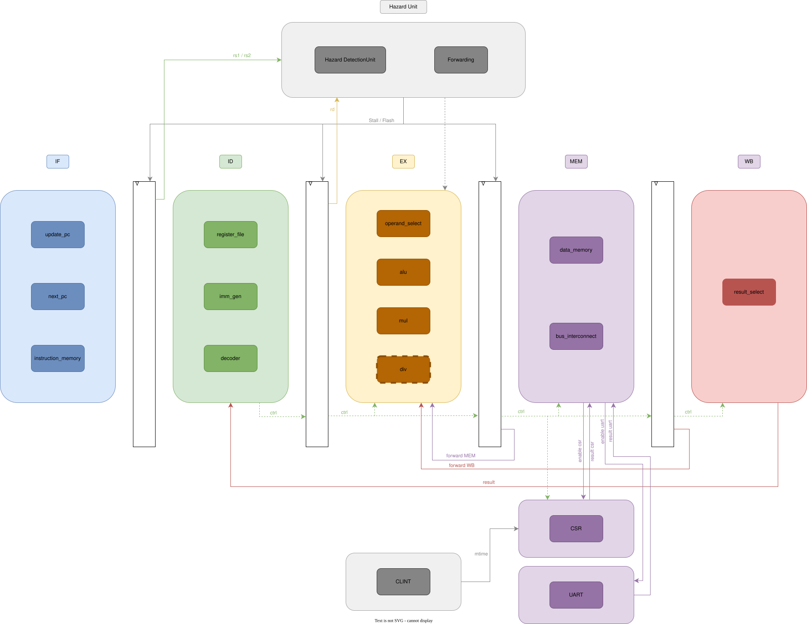

# RISC-V CPU Core (RV32IM)

## Use of AI  
This project was written entirely by me. AI did not write a single line in this project.  
I use it as a tool to understand concepts and help with debugging if I struggel for more than 1h. 

## Overview

A clean, modular **pipelined RISC-V CPU** implementing the **RV32IM** instruction set in SystemVerilog.  

---

## Design 

### Architecture

  
Left out trivial connections, i.e. instruction_memory -> decoder for improved overview  

---

## Toolchain

| Tool | Purpose |
|---|---|
| [Verilator](https://www.veripool.org/verilator/) | RTL simulation, capable of useful UVM since v.5050 |
| `riscv64-unknown-elf-gcc` | Compile assembly test programs |
| [Surfer](https://surfer-project.org/) | View `.vcd` / `.fst` waveforms |
| Vivado | FPGA synthesis, implementation and STA |

---

### FPGA (Zybo Z7)

Synthesize and implement with Vivado using `synth.tcl` and `Zybo-Z7-Master.xdc`.  
After programming the bitstream, connect via a serial terminal at **115 200 baud** to interact with the running CPU over UART.

---

## Software

This CPU is going to run FreeRTOS. If you want to use it, you do not have to implement anything manually. All ports and Board Support Packages are configured and the kernel is loaded in the project already.  
  
Just run the command `make os` while being in the root dir. It will put the `.elf` and `.dis` file for debugging and `.mem` file that's read in the bram via `$readmemh` in the `build_os` folder

---

## Simulation

All Simulations run with $\frac{1}{5ns} = 200MHz$  

Requires the `riscv64-unknown-elf-gcc` to compile c -> .mem file  

---

## Implementation Status

| Feature                                            | Status |
|----------------------------------------------------|----|
| RV32I base instruction set                         | ✅ |
| RV32M multiply/divide                              | ✅ |
| Machine-Mode CSRs (`mstatus`, `mepc`, `mcause`, …) | ✅ |
| Trap/exception handling (M-mode)                   | ✅ |
| Misaligned load/store/fetch exceptions             | ✅ |
| CLINT (`mtime` / `mtimecmp`)                       | ✅ |
| Memory-mapped I/O bus                              | ✅ |
| Timer interrupts                                   | ✅ |
| 6-stage pipeline (forwarding, hazard detection)    | ✅ |
| UART peripheral (115 200 baud, TX + RX)            | ✅ |
| SVA assertion coverage                             | ✅ |
| RISC-V ISA test suite (rv32ui / rv32um / rv32mi)   | ✅ |
| Bare-Metal on FPGA with UART                       | ✅ |
| FreeRTOS bring-up                                  | 🟨 |
| FreeRTOS on FPGA                                   | 🟥 |

---

## Timing

Clock: 90 MHz (11.1 ns period)  
WNS: +0.361 ns, 0 timing violations  
