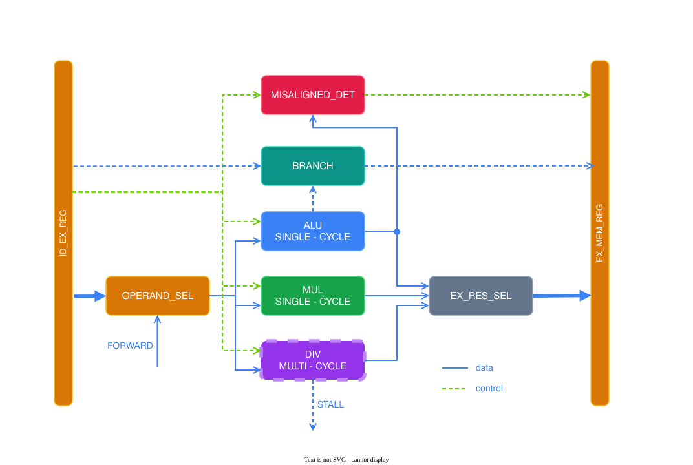
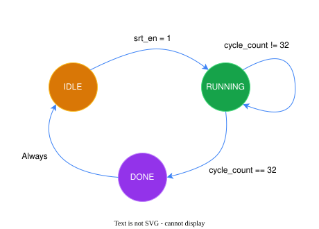

# OVERVIEW

    
     
     
     

# COMPONENTS
## MISALIGNED_DET
| Exception        | Triggered when                         | Checked bits |
|------------------|----------------------------------------|--------------|
| misaligned_fetch | JALR target (`pc_src_ex == 10`)        | `[1:0]`      |
| misaligned_load  | LH / LHU                               | `[0]`        |
|                  | LW                                     | `[1:0]`      |
| misaligned_store | SH                                     | `[0]`        |
|                  | SW                                     | `[1:0]`      |

  

## ALU
### FLAGS
| Flag   | Definition        | Usage                                                   |
|--------|-------------------|---------------------------------------------------------|
| `zero` | `result == 0`     | BEQ / BNE, ALU must compute SUB                         |
| `lt`   | `result[0]`       | BLT / BGE / BLTU / BGEU, ALU must compute SLT / SLTU    |

  

## MUL
Purely combinational, the result is available in the same cycle, so no stall is
required, at the cost of a long critical path.

  

## DIV

    

Divisor and dividend are first normalized with a leading zero detector (LZD), so
that the most significant bit sits at the top. Each cycle the digit selector
picks a quotient digit q in {-1, 0, 1} by comparing the partial remainder
against ±1/3 of the divisor, and the remainder is updated with `2R - q·D`.
Because q can be negative, no full comparison is required per step, which keeps
the critical path short, and the quotient is reconstructed at the end from
`quotient_pos - quotient_neg` and shifted back by the normalization offset.

| Case             | Latency                                    |
|------------------|--------------------------------------------|
| Regular          | 34 cycles (1 IDLE + 32 RUNNING + 1 DONE)   |
| Division by zero | 2 cycles (IDLE → DONE)                     |

  

## BRANCH_UNIT
| `pc_src` | Instruction | Taken when      | `pc_src_ex` taken / not taken |
|----------|-------------|-----------------|-------------------------------|
| `10`     | JALR        | always          | `10`                          |
| `01`     | JAL         | always          | `01`                          |
| `01`     | BEQ         | `zero`          | `01` / `00`                   |
| `01`     | BNE         | `!zero`         | `01` / `00`                   |
| `01`     | BLT / BLTU  | `lt`            | `01` / `00`                   |
| `01`     | BGE / BGEU  | `!lt`           | `01` / `00`                   |
| `00`     | other       | never           | `00`                          |

  

## OPERAND_SEL
### FORWARDING
| `forward_x` | Source       | Usage                                                                 |
|-------------|--------------|-----------------------------------------------------------------------|
| `00`        | Register file| No hazard                                                             |
| `10`        | EX/MEM       | `rd` of the previous instruction == `rs` (has priority)               |
| `01`        | MEM/WB       | `rd` of the instruction two before == `rs`, no match in EX/MEM        |