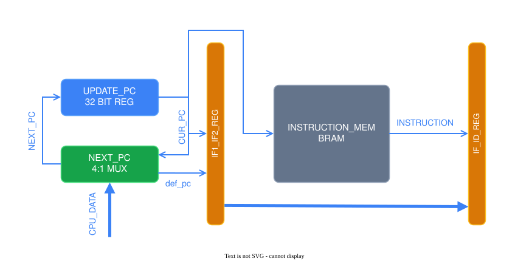

# OVERVIEW

    
     
     
     

CUR_PC is bypassed to the `INSTRUCTION_MEM` directly and sync instruction with pc, due to the BRAM taking 1 cycle to get the data.  
This causes an extra cycle penalty, when flushed

  

# COMPONENTS
## UPDATE_PC
| Parameter    | Value                                          |
|--------------|------------------------------------------------|
| Reset vector | `0x0001_0000`, asynchronous reset              |
| Stall        | `pc_stall` (load-use hazard, division)         |

On trap / mret the PC is never stalled, `pc_stall` is overridden by the hazard unit.

  

## NEXT_PC
| Priority | Condition              | Next PC           |
|----------|------------------------|-------------------|
| 1        | `trap_taken`           | `csr_pc` (mtvec)  |
| 1        | `mret_taken`           | `csr_pc` (mepc)   |
| 2        | `pc_src_ex = 00`       | PC + 4            |
| 2        | `pc_src_ex = 01`       | `imm_res`         |
| 2        | `pc_src_ex = 10`       | `alu_res`         |

`pc_src_ex` comes from the branch unit in the EX stage, not from the decoder.  
`pc_default` (PC + 4) is computed once here and passed through the pipeline,
so WB can use it for JAL / JALR without an additional adder.

  

## INSTRUCTION_MEM
| Parameter | Value                      |
|-----------|----------------------------|
| Kind      | BRAM, 1 cycle latency      |
| Size      | 16KiB                      |
| Init      | `$readmemh("program.hex")` |

IF stage is split, so the instruction and it's corosponting pc sit together in the same space

  

# MODULES
| Module | Path | Function |
|---|---|---|
| `instruction_memory` | `rtl/core/fetch/` | Instruction ROM, synchronous read |
| `next_pc` | `rtl/core/fetch/` | Computes next PC (sequential / branch / jump / trap) |
| `update_pc` | `rtl/core/fetch/` | PC register |