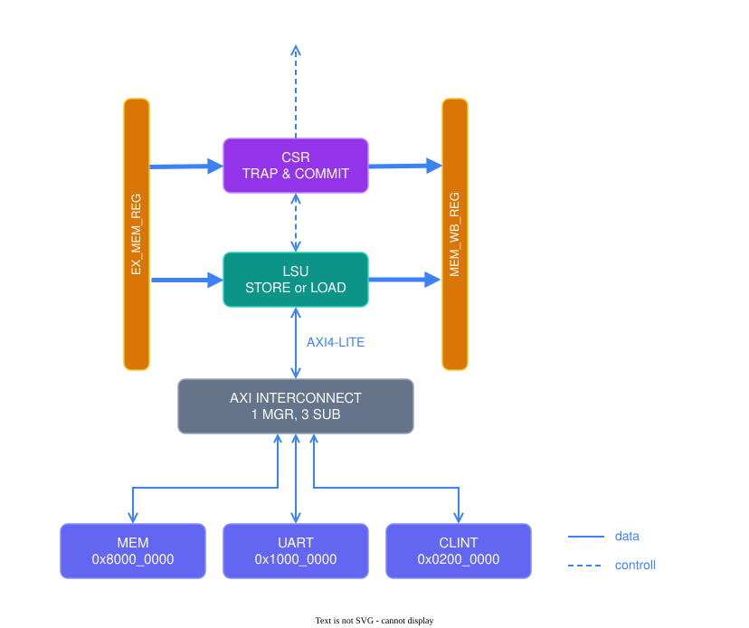

# OVERVIEW

    
     
     
     

  
| AREA   | BASE          | END           | SIZE   |  
|--------|---------------|---------------|--------|  
| MEM    | `0x8000_0000` | `0x8000_1FFF` | 8  KiB |  
| UART   | `0x1000_0000` | `0x1000_000B` | 12 B   |  
| CLINT  | `0x0200_0000` | `0x0200_BFFF` | 48 KiB |   

  
  

# COMPONENTS
## LSU

### BUS INTERFACE
AXI4-LITE, see [AMBA AXI Specification](https://developer.arm.com/documentation/ihi0022/latest).

| Parameter          | Value                                  |
|--------------------|----------------------------------------|
| Address width      | 32 bit                                 |
| Data width         | 32 bit                                 |
| Outstanding        | 1 transaction (blocking)               |
| Write strobes      | Used for SB / SH                       |
| Error response     | SLVERR / DECERR raise access fault     |

### Supported Instructions
| Instruction | Width   | Extension | Alignment     |
|-------------|---------|-----------|---------------|
| LB / LBU    | 8 bit   | sign/zero | any           |
| LH / LHU    | 16 bit  | sign/zero | 2-byte        |
| LW          | 32 bit  | -         | 4-byte        |
| SB / SH / SW| 8/16/32 | -         | as above      |

  
  

## UART
| KIND   | Offsett       | DESCRIPTION            |
|--------|---------------|------------------------|
| TX     | `0x0000_0000` | Data to send           |
| STATUS | `0x0000_0004` | Status of transmission |
| RX     | `0x0000_0008` | Received data          |  

  
  

## CLINT
| KIND        | Offsett       | DESCRIPTION                                     |
|-------------|---------------|-------------------------------------------------|
| MSIP        | `0x0000_0000` | Flag for software interrupt                     |
| MTIMECMP_LO | `0x0000_4000` | Lower part of comparevalue for timer interrupt  |
| MTIMECMP_HI | `0x0000_4004` | Higher part of comparevalue for timer interrupt |
| MTIME_LO    | `0x0000_BFF8` | Lower part of freerunning clock                 |
| MTIME_HI    | `0x0000_BFFC` | Higher part of freerunning clock                |

  
  

## CSR

### EXCEPTIONS

| mcause | Cause                    | mtval          |
|--------|--------------------------|--------------- |
| 0      | Instruction misaligned   | Fault address  |
| 2      | Illegal Instruction      | Instruction    |
| 3      | Breakpoint               | 0              |
| 4      | Load address misaligned  | Fault address  |
| 6      | Store address misaligned | Fault address  |
| 11     | Environment call         | 0              |

### TRAP ENTRY / MRET
On trap:
1. mepc   ← PC of trapping instruction
2. mcause ← cause
3. mtval  ← see table
4. MPIE   ← MIE, MIE ← 0
5. PC     ← mtvec

On mret: MIE ← MPIE, MPIE ← 1, PC ← mepc