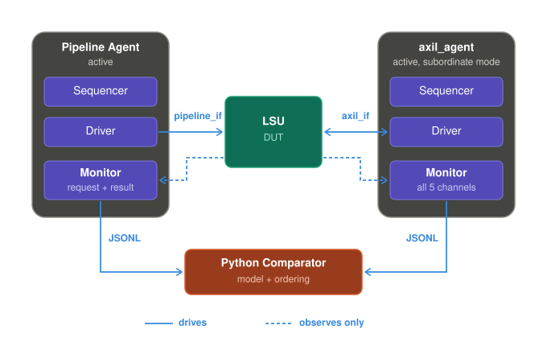
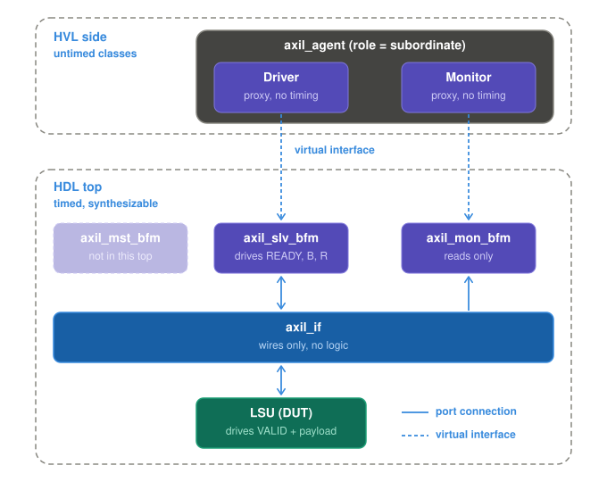
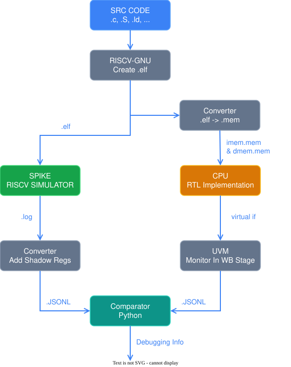

# LSU TEST  
### Testbench architecture  
  
### AXI BFM architecture
  
The BFM is spereated in 3 parts. Depending on the AXI-Lite mode 2 of them are activated:  
Manager-Mode: `axil_mon_bf` + `axil_mgr_bfm`  
Subordinate-Mode: `axil_mon_bf` + `axil_sub_bfm`  
### Lockstep architecture

---

## Verification

### UVM (IEEE 1800.2-2020)
UVM testbench with HDL/HVL separation via split transactor, enabling FPGA-based co-emulation. Synthesizable BFM and DUT on hardware, untimed transaction-level stimulus on the host increasing testing speed x100

---

## Restrictions  

Due to verilator being 2 state (1/0) and not 4 state (1/0/x/z) it's not garanteed, every cornercase is verified correctly

---  

## Spike Cosim  

### How it works

A package is sent through the stages together with the instruction, following the `RVFI` convention from formal verification. Each valid instruction gets monitored after being commited in the WB stage.   
After the entire run the result gets compared with a result created by Spike, the software reference model, build by the founders of RISC-V  


### Agents
| Name   | Purpose |
|--------|---------|
| retire | Monitor what happend per instruction, sits at the WB stage |
| arch   | Monitor each tick how anything happend via binds to the `pl_cpu` to enable coverage |

### Specs

To enable HDL/HVL seperation, the items use batching and store 1k actions each  

retire agnt monitors, whenever valid_instr is high

### Tests
---

### Strategy for debbuging til FreeRTOS

- Offline lockstep for complete core, with synchronous traps => FreeRTOS running without context switch
- Cooperative FreeRTOS without ticks in lockstep

## Legacy due to UVM learnings

### Testbenches

| Testbench | Path | Covers |
|---|---|---|
| `tb_sc_cpu` | `verify/tb/core/` | Full single-cycle CPU |
| `tb_pl_cpu` | `verify/tb/pipeline/` | Full pipelined CPU |
| `tb_fwd_integration` | `verify/tb/pipeline/` | Forwarding unit integration |
| `tb_hazard_integration` | `verify/tb/pipeline/` | Hazard unit integration |
| `tb_alu` | `verify/tb/alu/` | ALU top-level |
| `tb_STR2` | `verify/tb/muldiv/srt2/` | SRT-2 divider end-to-end |
| `tb_LZD` | `verify/tb/muldiv/srt2/` | Leading-zero detector |
| `tb_normalize` | `verify/tb/muldiv/srt2/` | Operand normalizer |
| `tb_DigitSelector` | `verify/tb/muldiv/srt2/` | Digit selector |
| `tb_RemainderUpdate` | `verify/tb/muldiv/srt2/` | Remainder update |
| `tb_uart` | `verify/tb/external/` | UART top-level (TX + RX loopback) |
| `tb_uart_tx` | `verify/tb/external/` | UART transmitter |
| `tb_uart_baud` | `verify/tb/external/` | Baud rate generator |

Run a specific testbench (with coverage and waveforms):

```bash
make sim-uart         # UART top
make sim-uart_tx      # UART transmitter
make sim-uart_baud    # Baud generator
make sim-fwd_integration
make sim-hazard_integration
```

### SVA (SystemVerilog Assertions)

Formal/simulation assertions are in `verify/assertions/` and attached to the DUT via bind files in `verify/bind/`.

| Assertion Module | Bind File | Covers |
|---|---|---|
| `assert_fwd_integration` | `fwd_bind.sv` | Forwarding correctness — correct data selected for EX operands under all hazard combinations |
| `assert_hazard_integration` | `hazard_bind.sv` | Hazard detection — stall and flush signals asserted at the right cycles for load-use and control hazards |
| `assert_imm_gen` | *(core/decode)* | Immediate sign-extension for all formats |